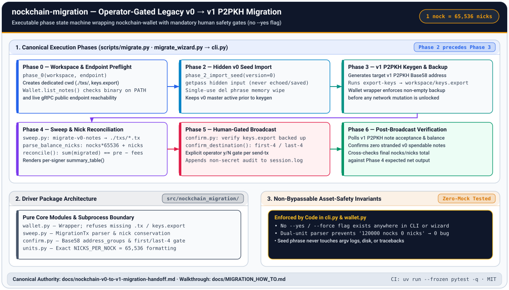

# nockchain — legacy v0 → v1 wallet migration

Open-source, operator-gated tooling that implements the Nockchain legacy v0 → v1
P2PKH wallet migration runbook as executable phases.

Every transaction broadcast requires an explicit operator confirmation for that
transaction. The [operator walkthrough](docs/MIGRATION_HOW_TO.md) describes the
gates and the failure playbook.

Start with the [documentation index](docs/README.md) for the runbook, code map,
test command, and [manuscript source and build instructions](docs/manuscript/README.md).
